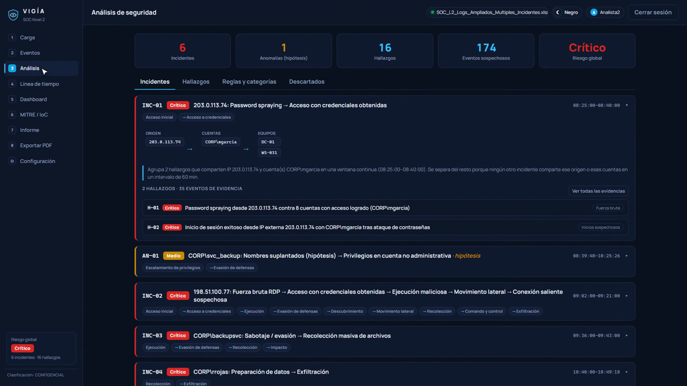
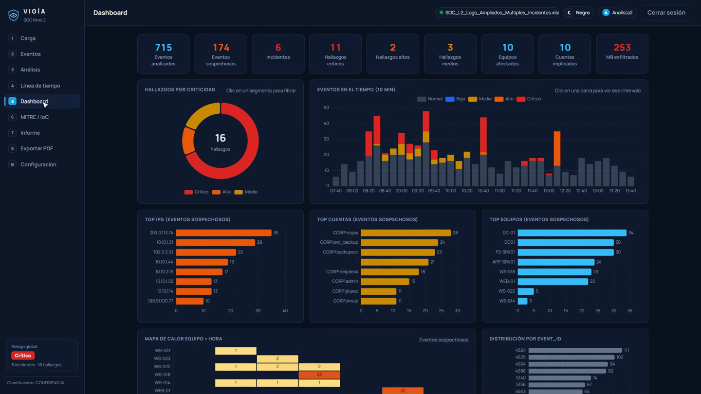
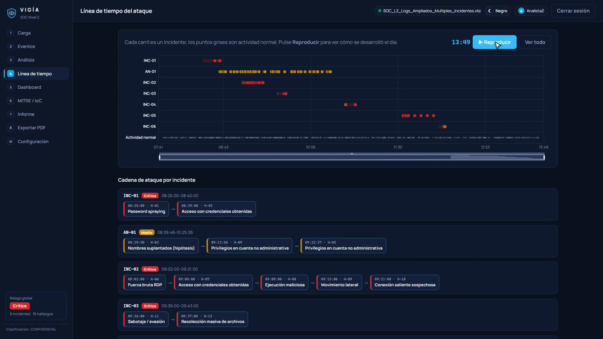
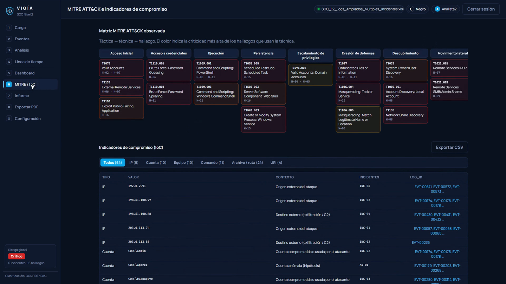
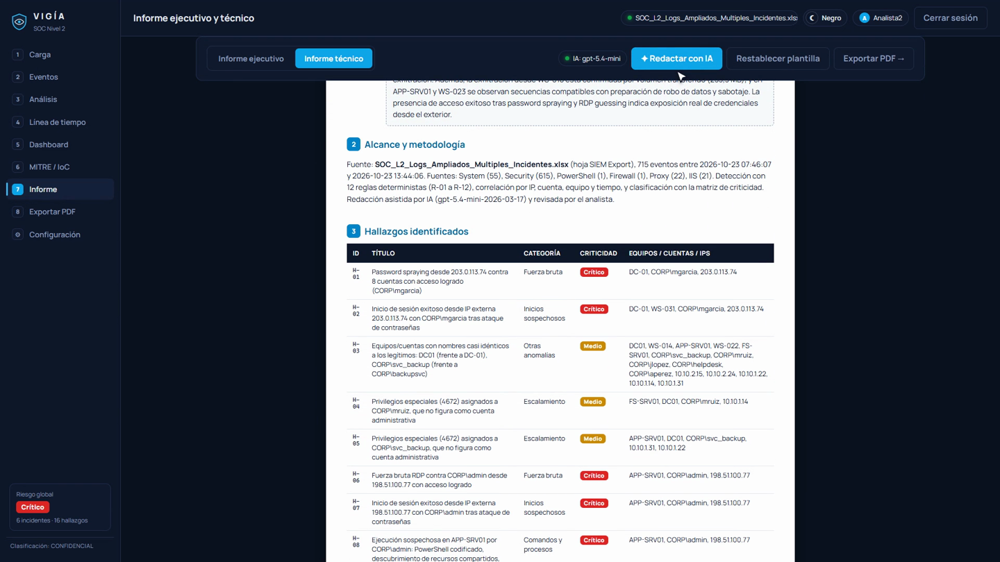

# VIGÍA · Plataforma de Análisis de Incidentes (SOC Nivel 2)

Aplicación web que investiga un posible incidente de seguridad a partir de los logs exportados de un SIEM. Detecta y correlaciona la actividad maliciosa, clasifica su criticidad y genera un **informe técnico** y otro **ejecutivo** en PDF. Para la redacción usa IA de forma opcional.

Proyecto desarrollado como reto final del *Bootcamp Analista SOC Nivel 2*.



| Dashboard interactivo | Línea de tiempo del ataque |
|---|---|
|  |  |
| **MITRE ATT&CK e IoC** | **Informe asistido por IA** |
|  |  |

## Inicio rápido
Requisito: **Node.js 20 o superior**.

```bash
git clone <url-del-repositorio>
cd vigia-soc
npm install
cp .env.example .env        # en Windows: copy .env.example .env
npm run dev
```
Abra **http://localhost:5173** e inicie sesión con las credenciales definidas en `.env` (por defecto `Analista2` / `Analista2`). Después cargue el Excel exportado del SIEM.

Modo producción: `npm run build && npm start`; la interfaz y la API quedan en http://localhost:3001.

### IA (opcional)
Añada su clave en `.env` (`OPENAI_API_KEY=...`; se obtiene en https://platform.openai.com/api-keys). Sin clave, el informe se redacta con plantillas deterministas y la aplicación funciona igual.

### Datos de entrada
La aplicación espera un `.xlsx` con la hoja `SIEM Export` y estas 12 columnas:

`Log_ID, Timestamp, Hostname, Event_ID, User, Source_IP, Destination, Log_Source, Event_Description, Process_CommandLine, Result, Severity`

El archivo del laboratorio **no se incluye** en el repositorio. Los `.xlsx` están excluidos en `.gitignore`.

## Módulos
| # | Módulo | Qué hace |
|---|---|---|
| 1 | Carga | Valida la hoja, las columnas, las fechas y los Log_ID; informa de la calidad de los datos. El archivo original no se modifica. |
| 2 | Eventos | Tabla con búsqueda, 8 filtros, paginación y detalle de cada evento con los hallazgos que lo citan. |
| 3 | Análisis | Incidentes, hallazgos, reglas por categoría y falsos positivos descartados, con evidencias y acciones. |
| 4 | Línea de tiempo | Carriles por incidente con reproducción animada y cadena de ataque. |
| 5 | Dashboard | Indicadores y gráficos interactivos: un clic en un gráfico filtra los eventos. |
| 6 | MITRE / IoC | Matriz ATT&CK observada e indicadores de compromiso exportables a CSV. |
| 7 | Informe | Versión ejecutiva y técnica, editables en pantalla, con redacción por IA y validación de Log_ID. |
| 8 | Exportar PDF | Portada, índice, tablas, gráficos y numeración de páginas. |
| ⚙ | Configuración | Modo negro/blanco, umbrales de detección, activos críticos y cuentas privilegiadas/de servicio. |

## Metodología
- **Detección determinista:** 12 reglas, de R-01 a R-12 ([src/lib/engine.js](src/lib/engine.js)).
  - Cubren password spraying, fuerza bruta, inicios externos, movimiento lateral, explotación web, persistencia, comandos sospechosos, privilegios, acceso masivo, exfiltración, nombres suplantados y borrado de registros.
  - Los umbrales están documentados y se pueden editar.
  - El mismo archivo con la misma configuración da siempre el mismo resultado.
- **Correlación:** los hallazgos que comparten una IP externa, una cuenta o un equipo sospechoso dentro de una ventana temporal se agrupan en un incidente, y se explica por qué se separa del resto.
- **Criticidad:**
  - Se aplica la matriz Crítico, Alto, Medio y Bajo.
  - Un hallazgo sube un nivel si se dan dos o más factores agravantes: activo crítico, cuenta privilegiada o de servicio, éxito, origen externo, evasión o exfiltración.
  - La columna Severity del SIEM se muestra solo como referencia.
- **Hipótesis:** lo que no puede confirmarse con los registros se marca como hipótesis, indicando qué evidencia faltaría.

## Uso responsable de la IA
- **Modelo:** `gpt-5.4-mini` (OpenAI), configurable con `AI_MODEL`. La clave permanece en el servidor.
- **Qué hace:** solo redacta. No detecta ni clasifica.
- **Qué recibe:** los hallazgos estructurados con sus Log_ID.
- **Formato de la respuesta:** se exige un JSON Schema estricto y se valida al recibirlo.
- **Instrucciones del modelo:** no inventar datos, citar evidencias, respetar la criticidad y marcar las hipótesis.
- **Control de los Log_ID:** el servidor y la interfaz rechazan los Log_ID que no existen en el archivo.
- **Trazabilidad:** el PDF indica si el texto se redactó con IA o con plantilla.

## Seguridad
- Credenciales validadas en el servidor con comparación en tiempo constante; sesión con token HMAC-SHA256 de 8 h.
- Bloqueo de 5 minutos tras 5 intentos fallidos por IP, con registro de los intentos.
- Los secretos solo viven en `.env`, que está excluido del repositorio. Use `.env.example` como plantilla.

## Estructura
```
server/            API Express: login, sesión e IA (ai.js)
src/lib/           parse.js (Excel), engine.js (reglas y correlación), report.js, pdf.js, charts.js, mitre.js
src/views/         un archivo por módulo
src/components/    tabla de eventos, gráficos, login y estructura
scripts/           verificación por línea de comandos (lectura, análisis e IA)
docs/              capturas
```

Verificación sin navegador:
```bash
node scripts/check-parse.mjs ruta/al/archivo.xlsx
node scripts/check-analysis.mjs ruta/al/archivo.xlsx
node scripts/check-ai.mjs ruta/al/archivo.xlsx      # requiere el servidor en marcha y OPENAI_API_KEY
```

## Tecnología
React 18 + Vite, Framer Motion, Apache ECharts, SheetJS, jsPDF + autoTable, Express 5, SDK de OpenAI, Zod y la tipografía Manrope.
